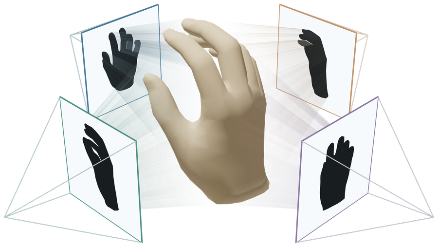
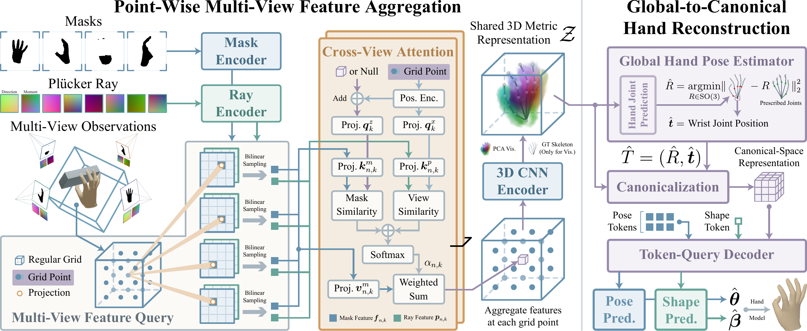

<h1 align="center">Hand in Silhouette</h1>

<p align="center">
  <strong>Synthetic-to-Real Multi-View Hand Reconstruction via Binary Masks</strong>
</p>

<p align="center">
  <a href="https://lycui.com/">Leiyao Cui</a> ·
  <a href="https://leleucla.github.io/">Lecheng Ruan</a>* ·
  <a href="https://zihangzhao.com/">Zihang Zhao</a>*<br>
  Future Lab, HEC Group<br>
  <sub>* Corresponding authors</sub>
</p>

<div align="center">

<!-- prettier-ignore -->

[](https://arxiv.org/abs/2611.16339) [](https://silhand26.github.io/) [](#pretrained-model) [](https://huggingface.co/datasets/Leiyao-Cui/SilHand)

</div>

<p align="center">
  <a href="assets/teaser.png">
    
  </a>
</p>
<p align="center">
  <em>Multi-view silhouettes constrain the same 3D hand geometry. Figure 1 from the paper.</em>
</p>

Official implementation of **SilHand**. Given synchronized binary hand masks and calibrated cameras, SilHand reconstructs the hand's global pose, articulation, and shape.

**The idea:** binary masks provide a common geometric representation for synthetic and real observations. Trained on 46.8k synthetic grasping poses and 60k free-hand samples, SilHand transfers directly to five real-world benchmarks.

This release provides pretrained weights and inference/evaluation on the five real-world test sets. The checkpoint supports **right hands**.

## Method

<p align="center">
  <a href="assets/framework.png">
    
  </a>
</p>

**Framework overview (Figure 3).** SilHand projects a metric 3D grid into each camera to query mask and Plücker-ray features. Cross-view attention and a 3D CNN build a shared 3D representation. The model then estimates global hand pose, canonicalizes the evidence, and decodes hand articulation and shape.

## Results

Clean results from Table 1, in mm ↓. Inputs are masks rendered from reference hand geometry, retaining object occlusion.

| Dataset | MPVPE | RR-V | PA-V | MPJPE | RR-J | PA-J |
| :--- | :---: | :---: | :---: | :---: | :---: | :---: |
| DexYCB-MV | 2.07 | 1.63 | 1.12 | 2.12 | 1.69 | 1.16 |
| HO3D-MV | 2.79 | 2.70 | 1.83 | 2.76 | 2.67 | 1.76 |
| OakInk-MV | 2.95 | 2.90 | 2.25 | 3.00 | 2.95 | 2.25 |
| ARCTIC-MV | 2.99 | 2.97 | 2.20 | 3.00 | 2.99 | 2.18 |
| InterHand-MV | 3.52 | 3.39 | 2.18 | 3.59 | 3.45 | 2.17 |

RR denotes wrist-relative error; PA denotes Procrustes alignment. V and J refer to vertices and joints.

## Installation

Run from the repository root. The validated environment uses Python 3.12 and PyTorch 2.12.1 with CUDA 13.0.

```bash
conda create -n silhand python=3.12 -y
conda activate silhand
pip install torch==2.12.1 --index-url https://download.pytorch.org/whl/cu130
pip install setuptools wheel
pip install -r requirements.txt --no-build-isolation
```

**Download MANO separately.** Register at the [official MANO website](https://mano.is.tue.mpg.de/), accept its license, and extract **MANO v1.2** so that the model is at:

```text
pretrained_weight/mano_v1_2/models/MANO_RIGHT.pkl
```

## Pretrained model

The paper's inference weights are included at [`pretrained_weight/silhand.pth`](pretrained_weight/silhand.pth) (**9.3 MB**) and loaded automatically.

## Dataset

**Datasets:** [🤗 Hugging Face](https://huggingface.co/datasets/Leiyao-Cui/SilHand).

The release includes both synthetic data and preprocessed real-world datasets.

For benchmark evaluation, place the preprocessed test splits under `data/<dataset>/`.

## Reproduce the paper results

Install the benchmark renderer, DRTK, with a CUDA toolkit/compiler available:

```bash
pip install git+https://github.com/facebookresearch/DRTK.git@b61eb06901d4bdd646563b0b15dca2409d04e718 --no-build-isolation --no-deps
```

Run all five **Clean** test splits:

```bash
for dataset in dexycb ho3d oakink arctic interhand; do
  CUDA_VISIBLE_DEVICES=0 python infer.py \
    "datamodule.real_dataset_dirs=[data/${dataset}]" \
    test.save_predictions=false \
    "log_dir=outputs/paper_clean/${dataset}" || break
done
```

Results are saved to `outputs/paper_clean/<dataset>/` as per-sample `metrics.csv` and summary `metrics.json`. Use an empty output directory for each run.

## Citation

If you use SilHand in your research, please cite:

```bibtex
@article{cui2026silhand,
  title   = {Hand in Silhouette: Synthetic-to-Real Multi-View Hand Reconstruction via Binary Masks},
  author  = {Cui, Leiyao and Ruan, Lecheng and Zhao, Zihang},
  journal = {arXiv preprint arXiv:2611.16339},
  year    = {2026},
  url     = {https://arxiv.org/abs/2611.16339}
}
```

## Acknowledgements

This implementation uses [MANO](https://mano.is.tue.mpg.de/), [manotorch](https://github.com/lixiny/manotorch), and [DRTK](https://github.com/facebookresearch/DRTK).
